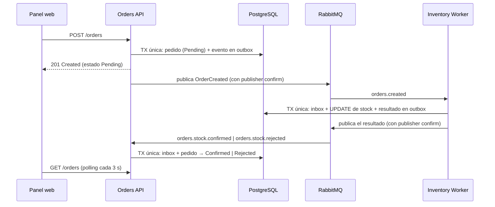

# OrderFlow

Sistema de pedidos con reserva de inventario. Cada pedido reserva stock antes de confirmarse: si alcanza, se **confirma**; si no, se **rechaza**. Dos servicios .NET 10 (API y Worker) se comunican de forma asíncrona por RabbitMQ y comparten PostgreSQL, y un panel web permite registrar pedidos y ver su estado.

Documentación complementaria: [Arquitectura y trade-offs](docs/ARCHITECTURE.md) - [Riesgos](docs/RISKS.md) - [Contexto del problema](docs/CONTEXT.md) - [Evidencias](docs/EVIDENCES.md)

## Contenido

- [Cómo correrlo](#cómo-correrlo)
- [Cómo funciona](#cómo-funciona)
- [Decisiones y trade-offs](#decisiones-y-trade-offs)
- [Idempotencia: cómo demostrarla](#idempotencia-cómo-demostrarla)
- [Manejo de fallos](#manejo-de-fallos)
- [Monitoreo](#monitoreo)
- [Tests](#tests)
- [Estructura del repositorio](#estructura-del-repositorio)
- [Alcance y pendientes conocidos](#alcance-y-pendientes-conocidos)
- [Kubernetes: queda para una futura entrega](#kubernetes-queda-para-una-futura-entrega)
- [Qué haría distinto con más tiempo](#qué-haría-distinto-con-más-tiempo)

## Cómo correrlo

Requisito: Docker con Compose v2. No hace falta configurar nada.

```bash
docker compose up -d --build
```

La primera vez construye las imágenes y el sistema queda listo en ~1 minuto. El compose encadena el arranque con healthchecks (Postgres y RabbitMQ → Worker → API → web). Sin `-d` se ven los logs en primer plano.

| Qué | URL | Nota |
| --- | --- | --- |
| **Panel web** | <http://localhost:3000> | Formulario de pedidos y lista con su estado |
| API | <http://localhost:8080> | `/orders`, `/health/live`, `/health/ready` |
| Consola de RabbitMQ | <http://localhost:15672> | Usuario `store`, contraseña `store_dev_password` (valores por defecto) |

**Probarlo en 1 minuto:** abrí el panel, entrá a *Nuevo pedido* y creá pedidos con estos SKU de ejemplo (se cargan solos al arrancar):

| SKU | Stock inicial | Resultado esperado |
| --- | ---: | --- |
| `ABC-01` | 100 | Confirmado |
| `XYZ-02` | 50 | Confirmado |
| `LMN-03` | 5 | Confirmado hasta agotar las 5 unidades; después, Rechazado |
| `OUT-04` | 0 | Rechazado (sin stock) |

El pedido aparece como *Pendiente* y cambia solo a *Confirmado* o *Rechazado* en unos segundos (la lista se refresca cada 3 s). Un SKU inexistente, un nombre vacío o una cantidad fuera de 1–100 muestran el error junto al campo.

También por API (bash; en Windows podés usar el archivo [`Store.WebApi.http`](src/Store.WebApi/Store.WebApi.http), cambiando el puerto a 8080):

```bash
curl -X POST http://localhost:8080/orders -H "Content-Type: application/json" \
     -d '{"customerName":"Ana","sku":"ABC-01","quantity":2}'
curl http://localhost:8080/orders
```

Para detenerlo: `docker compose down` (conserva los datos) o `docker compose down -v` (los borra).

### Configuración (opcional)

Todo es configuración por variables de entorno; **no hay secretos en el código** y la aplicación falla al arrancar, con un mensaje claro, si faltan `POSTGRES_*` o `RABBITMQ_*`. Para personalizar el entorno local, creá un archivo `.env` junto a `docker-compose.yml`. Docker Compose resuelve cada variable en este orden: tu shell → `.env` → el valor por defecto del compose.

| Variable | Por defecto | Para qué |
| --- | --- | --- |
| `POSTGRES_USER` / `POSTGRES_PASSWORD` / `POSTGRES_DATABASE_NAME` | `store` / `store_dev_password` / `store` | Credenciales y base de PostgreSQL |
| `RABBITMQ_USER` / `RABBITMQ_PASSWORD` | `store` / `store_dev_password` | Credenciales de RabbitMQ |
| `RABBITMQ_RETRY_DELAY_SECONDS` | `10` | Espera antes de reintentar un mensaje que falló |
| `WEB_PORT` / `API_PORT` / `RABBITMQ_MANAGEMENT_PORT` | `3000` / `8080` / `15672` | Puertos publicados en tu máquina (cambialos si están ocupados) |

Los valores por defecto son credenciales de **desarrollo local** que existen solo para que `docker compose up` arranque sin pasos manuales.

> **Ojo:** PostgreSQL y RabbitMQ aplican usuario, contraseña y el delay de reintento **solo la primera vez** (con el volumen vacío). Si cambiás esas variables con el sistema ya levantado, ejecutá antes `docker compose down -v`; si no, los servicios usarán valores nuevos contra volúmenes con los viejos y fallarán al autenticarse.

## Cómo funciona



- **Estados del pedido:** `Pending → Confirmed | Rejected`. Los estados finales no cambian. Un fallo técnico **nunca** se convierte en un rechazo: el pedido sigue `Pending` y el mensaje se reintenta.
- **API:** `POST /orders` (201 con el pedido, o 400 con los errores por campo), `GET /orders`, `GET /orders/{id}` (200 o 404).
- **Eventos** (contratos versionados, con `EventId` y `EventVersion`): `OrderCreated` → `orders.created`; `StockReserved` → `orders.stock.confirmed`; `StockRejected` → `orders.stock.rejected`, con el motivo `InsufficientStock`.
- **Mensajería:** un exchange `topic` durable (`orders`) con dos colas: `inventory.order-created` (la consume el Worker) y `orders.stock-results` (la consume la API). Cada cola tiene su `<cola>.retry` (demora con TTL y vuelve a la principal) y su `<cola>.dlq` (mensajes agotados o inválidos).
- **Datos:** un PostgreSQL con dos schemas, `orders` (API) e `inventory` (Worker), sin tablas compartidas. Cada servicio migra y siembra lo suyo al arrancar. PostgreSQL es la fuente de verdad del stock.
- **Frontend:** nginx sirve la app y reenvía `/api/*` a la API, por lo que el navegador solo habla con un origen (sin CORS).

## Decisiones y trade-offs

El detalle completo, con lo que se gana y lo que se cede en cada una, está en [ARCHITECTURE.md](docs/ARCHITECTURE.md#tradeoffs-aceptados). Las principales:

- **Entrega *at-least-once* con Outbox e Inbox**, no *exactly-once* (no existe entre una BD y un broker). El pedido y su evento se guardan en una sola transacción, un publicador independiente los envía con *publisher confirms*, y el consumidor descarta los duplicados con una clave única en la misma transacción que su efecto. A cambio hay duplicados en el broker, una tabla `processed_events` y hasta ~1 s de latencia por el *polling* del outbox.
- **Sin sobreventa por diseño:** la verificación y el descuento son una sola sentencia atómica (`UPDATE ... WHERE available >= @q`) más un `CHECK (available >= 0)`. No se confía en leer y luego escribir. Cede: un pedido tiene **un solo SKU**; con varios habría que bloquear filas en orden.
- **Tres estados, sin `ProcessingFailed`:** no se le miente al negocio, pero un evento que termina en la DLQ deja el pedido `Pending` hasta intervenir (ver [riesgos abiertos](docs/RISKS.md#riesgos-residuales-abiertos)).
- **Sin Valkey ni Saga:** PostgreSQL ya da el locking por fila y la idempotencia, y hay una sola transacción local por servicio. Valkey duplicaría fuentes de verdad; una Saga solo se justificaría con acciones compensables en otros servicios (pagos, envíos).
- **`POST /orders` devuelve 201**, que es lo que pide el enunciado; lo que se garantiza de forma síncrona es la persistencia, no el resultado.
- **nginx como proxy de `/api` en lugar de CORS:** el mismo build sirve en cualquier entorno (sin URL fijada al compilar) y no hay que configurar orígenes. Cede un `nginx.conf` de ~40 líneas.
- **Polling (3 s) en lugar de SignalR:** simple y suficiente; el tiempo real es un bonus que no se implementó.
- **Tests contra PostgreSQL real**, no mocks ni SQLite: la concurrencia y la atomicidad son propiedades de la base de datos. Se creó un servicio `tests` en el compose.
- **Credenciales por defecto en el compose** (solo desarrollo local) para que `docker compose up` no requiera pasos manuales; el código no tiene ningún secreto.

## Idempotencia: cómo demostrarla

**1. Automática.** El test `Duplicate_delivery_decrements_stock_only_once` procesa el mismo evento 12 veces (una aplicada, una repetida y 10 repetidas en paralelo) y comprueba que el stock se descuenta una sola vez (ver [Tests](#tests)).

**2. A mano, sobre el sistema corriendo.** Se vuelve a publicar exactamente el mismo mensaje en RabbitMQ y se comprueba que no pasa nada. (Mismo procedimiento que verifiqué contra la API de gestión de RabbitMQ.) Con los valores por defecto del compose:

1. Creá un pedido desde el panel (por ejemplo `XYZ-02`, cantidad 1) y esperá a que quede *Confirmado*.
2. Sacá su evento del outbox de la API:

   ```bash
   docker compose exec postgres psql -U store -d store -tAc "select payload from orders.outbox_messages order by occurred_at desc limit 1"
   ```

   Devuelve algo como `{"sku": "XYZ-02", "eventId": "…", "orderId": "…", "quantity": 1, "occurredAt": "…"}`. Anotá el stock actual: `docker compose exec postgres psql -U store -d store -tAc "select available from inventory.stock where sku='XYZ-02'"`.
3. En la consola de RabbitMQ (<http://localhost:15672>) → **Exchanges** → `orders` → *Publish message*:
   - Routing key: `orders.created`
   - Headers: `event_version` = `1` (tipo *Number*)
   - Properties: `delivery_mode=2`, `type=orders.created`, `message_id=<el eventId del paso 2>`
   - Payload: el JSON del paso 2
4. Resultado: el stock **no cambia**, el pedido sigue igual, y el Worker lo informa en su log:

   ```bash
   docker compose logs worker --tail 20
   # … Evento orders.created <eventId> ya procesado antes: duplicado ignorado.
   ```

(Si definiste otro usuario o base en tu `.env`, reemplazá `-U store -d store` por tus valores.)

## Manejo de fallos

Qué pasa con el pedido en cada caso. La columna *Verificado* indica **cómo** se comprobó; lo que no se probó de punta a punta está marcado.

| Escenario | Qué pasa | Verificado |
| --- | --- | --- |
| **Inventory (Worker) no responde** | `POST /orders` sigue respondiendo 201. El pedido queda `Pending` y su evento espera, durable, en `inventory.order-created`. Cuando el Worker vuelve, lo procesa y el pedido pasa a su estado final. | Sí, durante el desarrollo (procesos locales) |
| **El broker está caído cuando la API publica** | La API igual guarda el pedido y responde 201: el evento queda en `orders.outbox_messages` (con `attempts` y `last_error`) y el publicador reintenta con backoff exponencial (2ⁿ s, tope 60 s). Nunca se descarta; al volver el broker se publica solo. | Sí, durante el desarrollo (broker aparte) |
| **La API está caída cuando llega el resultado** | El resultado espera en `orders.stock-results`; al volver la API, el pedido pasa a su estado final. | Sí, durante el desarrollo |
| **Falla técnica al procesar un evento** (excepción del handler) | Se revierte **toda** la transacción (descuento de stock *y* registro en el inbox), el mensaje va a `<cola>.retry` y vuelve tras `RABBITMQ_RETRY_DELAY_SECONDS`. A los 5 intentos pasa a `<cola>.dlq` con `x-error`, intentos y cola de origen. El pedido sigue `Pending`; **no** se rechaza. | Sí, con un handler de prueba que falla (luego eliminado) |
| **Mensaje veneno** (tipo o versión desconocidos, JSON inválido) | Va directo a la DLQ, sin reintentos. | Sí |
| **Resultado contradictorio** (p. ej. `StockRejected` para un pedido ya `Confirmed`) o pedido inexistente | Se rechaza la transición, agota intentos y termina en la DLQ; el pedido no se toca. Repetir el mismo resultado es un *no-op*. | Sí |
| **Reconexión de los consumidores tras reiniciar RabbitMQ** | Diseñada: auto-recuperación del cliente y un *watchdog* que recrea un consumidor cuyo canal se cerró. | **No** verificada de punta a punta |
| **PostgreSQL caído en ejecución** | En el arranque, las migraciones reintentan hasta 10 veces. En ejecución, un consumidor falla, reintenta y llega a la DLQ; la API responde 500 (`ProblemDetails`). | **No** probado |

Para reproducirlos: `docker compose stop worker` (o `stop rabbitmq`), creá un pedido, y volvé a levantarlo con `docker compose start worker`.

**Revisar y recuperar la DLQ:** en la consola de RabbitMQ, *Queues* → `inventory.order-created.dlq` u `orders.stock-results.dlq` → *Get messages*. Cada mensaje conserva su motivo en los headers. La reinyección es manual, a propósito: reprocesar automáticamente un mensaje que ya falló 5 veces solo repetiría el fallo.

## Monitoreo

- **Salud:** `GET /health/live` (el proceso responde) y `GET /health/ready` (solo da OK cuando el Worker ya creó su schema y cargó el seed).
- **Colas, reintentos y DLQ:** consola de RabbitMQ (<http://localhost:15672>).
- **Logs** con `EventId`, `MessageId` y el `orderId` como identificador de correlación: `docker compose logs api --tail 100`, `docker compose logs worker --tail 100`.
- **Estado de los datos** (con `docker compose exec postgres psql -U store -d store -c "…"`):

  ```sql
  -- Eventos de la API sin publicar (si crece, el broker no está recibiendo)
  select count(*) from orders.outbox_messages where published_at is null;
  -- Los que están fallando al publicarse
  select id, event_type, attempts, last_error from orders.outbox_messages where published_at is null and attempts > 0;
  -- Pedidos atascados: Pending hace más de 5 minutos
  select id, sku, created_at from orders.orders where status = 'Pending' and created_at < now() - interval '5 minutes';
  -- Lo mismo para los resultados del Worker
  select count(*) from inventory.outbox_messages where published_at is null;
  ```

No hay métricas ni *tracing* distribuido (ver [RR4](docs/RISKS.md#riesgos-residuales-abiertos)).

## Tests

**Backend** (xUnit, 19 casos en 5 grupos): transiciones de estado, validación del pedido, idempotencia, rechazo por stock insuficiente sin tocar el stock, y **no sobreventa bajo concurrencia** (16 pedidos simultáneos de 2 unidades sobre un stock de 5: exactamente 2 se reservan, 14 se rechazan y queda 1 unidad). Los tres últimos corren contra PostgreSQL real: crean una base temporal, aplican las migraciones reales y la borran al terminar.

```bash
docker compose run --rm tests
```

Este comando usa el PostgreSQL del compose (lo levanta si hace falta) y no necesita nada instalado en tu máquina. Sin Docker: `dotnet test src/Store.slnx`, con un PostgreSQL accesible y `POSTGRES_USER`, `POSTGRES_PASSWORD`, `POSTGRES_DATABASE_NAME` (y opcionalmente `POSTGRES_HOST`/`POSTGRES_PORT`) como variables de entorno o *user-secrets*.

**Frontend** (Vitest + Testing Library, 24 casos en 4 archivos): validación del formulario, cliente HTTP, lista de pedidos y formulario de alta (errores del cliente y del servidor junto a cada campo, alerta ante una caída de conexión, y limpieza del formulario tras crear un pedido).

```bash
cd web && npm install && npm test
```

El build de Docker no ejecuta estos tests. Además, se comprobó el comportamiento del panel manejándolo en un navegador real (Edge): datos inválidos con el error visible bajo cada campo, error del servidor junto al SKU, un pedido válido pasando de *Pendiente* a *Confirmado* sin recargar, y una caída de conexión que muestra una alerta, conserva la lista y se recupera sola.

## Estructura del repositorio

```text
├── docker-compose.yml        Todo el sistema: postgres, rabbitmq, worker, api, web (+ tests)
├── src/
│   ├── Store.Core/           Dominio y casos de uso. No depende de PostgreSQL ni de RabbitMQ
│   ├── Store.Infrastructure/ EF Core, outbox/inbox, RabbitMQ (implementa los contratos de Core)
│   ├── Store.WebApi/         Orders API (Minimal APIs, health checks)
│   ├── Store.Inventory.Worker/ Consumidor de OrderCreated y reserva de stock
│   └── Store.Tests/          Tests de dominio y de concurrencia sobre PostgreSQL real
├── web/                      Panel React + Vite, servido por nginx (proxy /api → API)
└── docs/                     Arquitectura, riesgos y contexto
```

Tecnología: .NET 10 (ASP.NET Core, Worker Service, EF Core), PostgreSQL 18, RabbitMQ 4, React 19 + TypeScript + Vite. Imágenes multi-stage, livianas y sin privilegios de root: API ~190 MB, Worker ~150 MB, web ~90 MB.

## Alcance y pendientes conocidos

| Ítem | Estado |
| --- | --- |
| Backend en .NET 10 (bonus) | Hecho |
| Kubernetes (bonus) | **No implementado**, por tiempo: ver la sección siguiente |
| Tiempo real con SignalR (bonus) | No implementado; el panel usa *polling* cada 3 s |
| Tests del frontend | Hecho: 24 casos en verde (ver [Tests](#tests)) |
| Autenticación | Fuera del alcance de la prueba (riesgo residual [RR2](docs/RISKS.md#riesgos-residuales-abiertos)) |
| Paginación de `GET /orders` | No implementada: devuelve todos los pedidos |

Los riesgos abiertos y su plan están en [RISKS.md](docs/RISKS.md#riesgos-residuales-abiertos).

## Kubernetes: queda para una futura entrega

Por cuestiones de tiempo no se escribieron los manifiestos. El despliegue previsto, a partir de lo que el sistema ya expone:

- Un `Deployment` y un `Service` por componente (API, Worker, web); el Worker y el publicador de outbox pueden escalar horizontalmente (`FOR UPDATE SKIP LOCKED` + inbox idempotente).
- `ConfigMap` para lo no sensible (hosts, puertos, `RABBITMQ_RETRY_DELAY_SECONDS`) y `Secret` para las credenciales `POSTGRES_*` y `RABBITMQ_*`: la aplicación ya las lee del entorno.
- *Probes* con endpoints que ya existen: *liveness* `/health/live` y *readiness* `/health/ready` en la API, y `/healthz` en la web. Además, límites de CPU y memoria por contenedor.
- Las migraciones hoy corren al arrancar, lo cual es cómodo en el compose; en Kubernetes irían en un `initContainer` o un `Job`, con un usuario de base con permisos de DDL.
- PostgreSQL y RabbitMQ como servicios gestionados o con un operador, no como `Deployment` simples; un `Ingress` expondría el servicio web, que ya reenvía `/api` a la API.

## Qué haría distinto con más tiempo

1. **Detectar pedidos atascados:** un proceso que alerte los `Pending` de más de N minutos (la consulta está en [Monitoreo](#monitoreo)) y evaluar un estado `ProcessingFailed`.
2. **Completar los tests:** añadir tests de integración con RabbitMQ real (reconexión de consumidores, reintentos y DLQ), que hoy comprobé a mano, y correr los tests del frontend en el build de Docker o en CI.
3. **Observabilidad:** OpenTelemetry con métricas de outbox pendiente, profundidad de la DLQ y latencia de procesamiento, además de *tracing* entre API y Worker.
4. **Autenticación y autorización** para la API y el panel de operaciones, más *rate limiting*.
5. **Tiempo real** con SignalR en lugar de *polling*.
6. **Retención:** purgar `outbox_messages` y `processed_events`, que hoy crecen sin límite.
7. **Pedidos con varios productos:** reserva todo-o-nada bloqueando las filas en orden ascendente de SKU dentro de una sola transacción.
8. **Operación:** migraciones como un job aparte con un usuario de privilegios mínimos para la aplicación, *quorum queues* y réplica de PostgreSQL, y los manifiestos de Kubernetes.
9. **Detalles:** paginación en `GET /orders`, retry exponencial también en el consumidor (hoy es de delay fijo) y un `.env.example` versionado.
