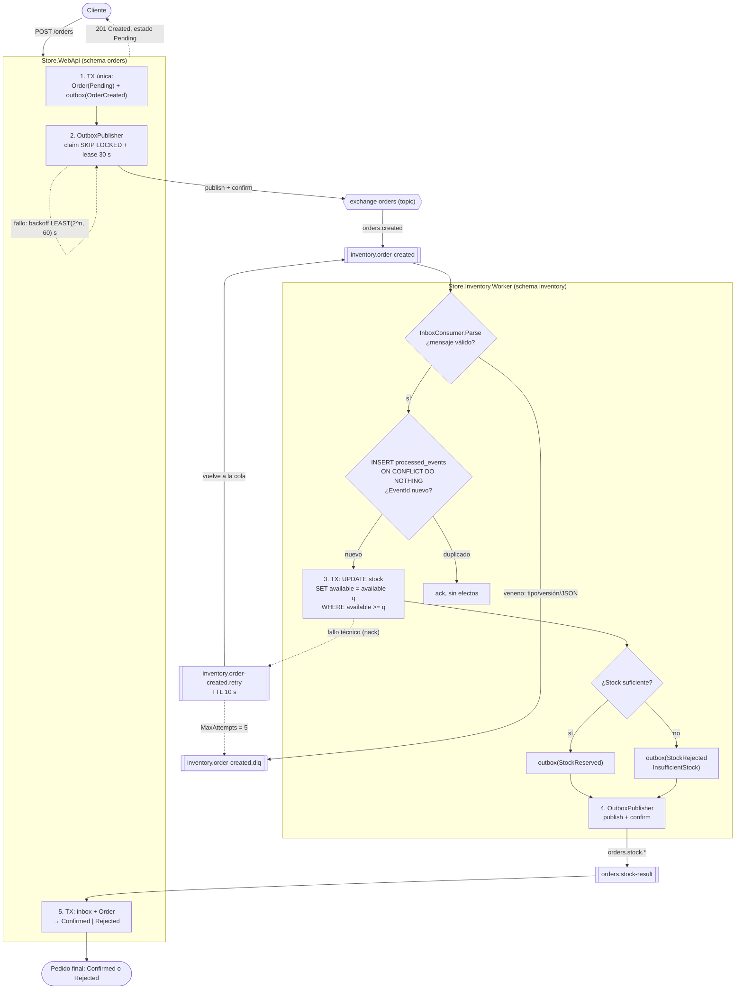

# Arquitectura

Este documento describe la arquitectura de la aplicación Store, incluyendo sus componentes principales, las tácticas de arquitectura aplicadas, los atributos de calidad priorizados y los tradeoffs aceptados.

## Tabla de contenido

- [Estructura del proyecto](#estructura-del-proyecto)
- [Tácticas de arquitectura](#tácticas-de-arquitectura)
- [Atributos de calidad priorizados (ISO/IEC 25010:2023)](#atributos-de-calidad-priorizados-isoiec-250102023)
- [Tradeoffs aceptados](#tradeoffs-aceptados)

---

## Estructura del proyecto

El backend de la aplicación `Store` está estructurado en varios proyectos que tienen como objetivo separar las responsabilidades y facilitar el mantenimiento, la escalabilidad y las pruebas.

- `Store.WebApi`: Contiene la configuración y el punto de entrada de la aplicación web, incluyendo la configuración de servicios, middlewares y endpoints.
- `Store.Core`: Contiene la lógica de negocio central, incluyendo casos de uso, validaciones y contratos.
- `Store.Infrastructure`: Contiene la implementación de la persistencia y otras dependencias externas.
- `Store.Inventory.Worker`: Contiene la lógica y los procesos en segundo plano relacionados con la gestión del inventario, incluyendo la actualización de stock y la sincronización con la base de datos.
- `Store.Tests`: Contiene los proyectos de pruebas automatizadas para los distintos componentes de la aplicación, incluyendo pruebas unitarias e integradas.

`Store.Core` no depende de PostgreSQL ni de RabbitMQ: expone contratos (`IOrderStore`, `IStockReservation`, `IEventOutbox`, `IIntegrationEventHandler<T>`) que `Store.Infrastructure` implementa.

### Flujo de extremo a extremo

Cada servicio es dueño de su schema en PostgreSQL (`orders`, `inventory`) y de sus propias tablas `outbox_messages` y `processed_events`.

## Tácticas de arquitectura

Cada táctica responde a un riesgo concreto (ver [RISKS.md](RISKS.md)).

| Táctica | Qué hace |
| ------- | -------- |
| **Transaction Outbox** | El cambio de estado y el evento que lo anuncia se guardan juntos en una sola transacción; un proceso independiente se encarga de publicarlo después. Elimina la escritura doble entre base de datos y broker. |
| **Inbox / Idempotent Consumer** | Cada evento procesado queda registrado por su identificador, en la misma transacción que su efecto de negocio. Si el evento llega de nuevo, se reconoce y no se vuelve a aplicar. |
| **Competing Consumers / Leasing** | Las instancias del publicador reclaman lotes de eventos de forma exclusiva y por un tiempo limitado. Pueden convivir varias sin bloquearse ni publicar lo mismo, y si una cae otra retoma su trabajo. |
| **Publisher Confirms** | Un evento solo se considera publicado cuando el broker confirma que lo recibió. |
| **Exponential Backoff** | Ante fallos de publicación, cada reintento espera más que el anterior, hasta un máximo. El evento nunca se descarta. |
| **Retry Queue (delay sin bloqueo)** | Los mensajes que fallan por causas transitorias esperan en una cola intermedia y luego vuelven a procesarse, sin bloquear a los consumidores. |
| **Dead Letter Queue** | Los mensajes que agotan sus reintentos, o que nunca podrán procesarse, se apartan a una cola de fallidos junto con el motivo del error, para revisarlos sin frenar el flujo. |
| **Poison Message Detection** | Los mensajes que no se pueden interpretar (tipo o versión desconocidos, formato inválido) se identifican y se envían directamente a la cola de fallidos, porque reintentarlos no sirve. |
| **Atomic Conditional Update** | La verificación de stock y su descuento ocurren en una única operación atómica de la base de datos, reforzada por una restricción que impide stock negativo. Garantiza que no haya sobreventa. |
| **Domain State Machine** | El pedido solo puede pasar de pendiente a confirmado o rechazado; los estados finales no cambian y cualquier transición inválida se rechaza. |
| **Event-Driven Architecture** | La API y el Worker se comunican únicamente mediante eventos de integración versionados, sin acoplarse entre sí. |
| **Schema per Service** | Cada servicio es dueño de sus datos dentro de la misma base, sin tablas compartidas, y gestiona su propia estructura e inicialización. |
| **Self-Healing Consumer** | Un supervisor detecta cuando el consumidor deja de recibir mensajes y lo recrea; al arrancar, se reintenta la conexión hasta que el broker esté disponible. |
| **Health Checks (liveness/readiness)** | Los servicios exponen si están vivos y si están listos para atender, y el arranque se encadena para que nadie inicie antes que sus dependencias. |
| **Dependency Injection** | Desacopla los componentes de sus dependencias, lo que da modularidad y permite probar la lógica crítica por el mismo camino que en producción. |
| **Secretos por entorno** | Ninguna credencial vive en el código: se leen del entorno y la aplicación no arranca si faltan. |

## Atributos de calidad priorizados (ISO/IEC 25010:2023)

Se priorizaron los siguientes atributos de calidad según las necesidades del negocio y las restricciones técnicas de la prueba. La norma usada es la ISO/IEC 25010 del 2023:

| Prioridad | Característica | Subcaracterísticas clave | Por qué importa aquí | Cómo se logra |
| :-------: | -------------- | ------------------------ | -------------------- | ------------- |
| 1 | **Reliability** (Fiabilidad) | Fault tolerance, Recoverability, Faultlessness, Availability | "Los fallos técnicos no deben dejar el sistema inconsistente." Un pedido perdido o un evento sin procesar es dinero. | Eventos guardados junto con el cambio de estado, procesamiento idempotente, confirmación del broker antes de dar algo por publicado, reintentos con cola de fallidos, recuperación automática de consumidores y almacenamiento persistente. |
| 2 | **Functional suitability** (Adecuación funcional) | Functional correctness, Functional completeness | "Un pedido debe reservar inventario antes de confirmarse": nunca se confirma sin stock ni se vende de más. | Reserva de stock atómica protegida por reglas en la base de datos, ciclo de vida del pedido controlado por estados y rechazos de negocio explícitos con su motivo. |
| 3 | **Security → Integrity** (Seguridad: integridad de datos) | Integrity, Confidentiality | La concurrencia no puede corromper el inventario; las credenciales no pueden filtrarse. | Restricciones de integridad en la base de datos, una transacción por evento, consultas parametrizadas y credenciales fuera del código. |
| 4 | **Maintainability** (Mantenibilidad) | Modularity, Testability, Analysability, Modifiability | El equipo debe poder evolucionar y probar el sistema sin miedo. | Capas separadas por contratos, componentes pequeños con una sola responsabilidad, lógica de negocio independiente del transporte, pruebas contra una base de datos real y logs estructurados. |
| 5 | **Performance efficiency** (Eficiencia de desempeño) | Capacity, Time behaviour | La concurrencia es una restricción explícita, no el objetivo principal. | Consumo concurrente configurable, publicación de eventos por lotes, consultas optimizadas sobre los pendientes y transacciones cortas que no quedan abiertas mientras se habla con el broker. |
| 6 | **Flexibility** (Flexibilidad) | Scalability, Installability, Replaceability | El Worker y el publicador deben poder escalar horizontalmente. | Varias instancias pueden repartirse el trabajo sin pisarse, consumidores idempotentes y despliegue completo con un solo comando. |
| 7 | **Compatibility** (Compatibilidad) | Interoperability | Debe integrarse con un sistema de mensajería. | Contratos de eventos versionados, enrutamiento flexible de mensajes y metadatos de identificación y correlación en cada mensaje. |

**No priorizados (a propósito):**

- **Interaction capability**: el panel web existe para operaciones, pero no condiciona la arquitectura del backend.
- **Safety**: el dominio (pedidos de una tienda) no tiene riesgo para personas o entorno.
- **Security (autenticación/autorización, no repudio)**: fuera del alcance de la prueba; está registrado como riesgo residual en [RISKS.md](RISKS.md).

## Tradeoffs aceptados

Cada decisión tiene un costo. Estos son los que aceptamos de forma consciente:

| Decisión | Qué ganamos | Qué cedemos | Por qué lo aceptamos |
| -------- | ----------- | ----------- | -------------------- |
| **Entrega *at-least-once* + Inbox** en lugar de *exactly-once* | Ningún evento se pierde; la idempotencia es verificable con un test. | Hay duplicados en el broker y una tabla `processed_events` que mantener. | Exactly-once entre BD y broker no existe; lo correcto es hacer los efectos idempotentes. |
| **Consistencia eventual** (el pedido nace `Pending`) | La API no espera al Worker ni se acopla a su disponibilidad. | El usuario no ve el resultado inmediato; hay que consultar el estado. | Es el requisito del negocio (reservar antes de confirmar, de forma asíncrona). |
| **Outbox con *polling* (1 s)** en lugar de CDC/LISTEN-NOTIFY | Simple, sin infraestructura extra, funciona con varias instancias. | Hasta ~1 s de latencia adicional y consultas periódicas a la BD. | La latencia es irrelevante para este flujo; CDC sería sobreingeniería. |
| **`UPDATE` condicional** en lugar de `SELECT ... FOR UPDATE` | Una sola sentencia atómica, sin locks explícitos ni riesgo de deadlock. | Solo reserva un SKU por pedido; un pedido multi-ítem exigiría bloquear filas en orden (por `sku`). | El modelo actual es un pedido = un SKU. Si cambia, la reserva se rediseña. |
| **Un pedido = un SKU** | Reserva atómica trivial; sin reservas parciales posibles. | Menos expresividad de negocio. | Mantiene la solución mínima y correcta para el alcance. |
| **Un solo PostgreSQL con dos schemas** en lugar de una BD por servicio | Operación simple (`docker compose up`) y migraciones propias por servicio. | Acoplamiento a nivel de infraestructura: una caída de la instancia afecta a ambos. | Los schemas no comparten tablas: separar en BDs distintas es un cambio de cadena de conexión, no de diseño. |
| **Sin Valkey/Redis** como base de datos en memoria | Una dependencia menos que operar y fallar. | Sin caché ni locks distribuidos. | PostgreSQL ya da locking por fila e idempotencia; añadir Valkey duplicaría fuentes de verdad. |
| **Retry con delay fijo** (cola `.retry` con TTL, 10 s por defecto) | Retraso sin bloquear consumidores, configurable por entorno. | No es exponencial en el consumidor (sí en el publicador). | Un delay fijo es predecible y suficiente con 5 intentos máximos. |
| **DLQ sin consumidor automático** | Un mensaje problemático no se pierde ni se reprocesa en bucle. | La recuperación es manual (inspeccionar y reinyectar). | Un reproceso automático de un mensaje que falló 5 veces solo repetiría el fallo. |
| **Sin estado `ProcessingFailed`** | La máquina de estados es mínima (`Pending → Confirmed \| Rejected`). Un fallo técnico NUNCA se disfraza de rechazo de negocio. | Un pedido cuyo evento termina en la DLQ queda `Pending` hasta intervención. | Decidimos no mentirle al negocio; la detección de pedidos atascados queda como mejora (ver [RISKS.md](RISKS.md)). |
| **`POST /orders` devuelve `201 Created`** | El pedido ya está persistido de forma durable y tiene URL consultable (`/orders/{id}`). | El `201` sugiere "creado", no "procesado": el estado sigue siendo `Pending`. | Refleja el hecho real: lo que se garantiza síncronamente es la persistencia, no el resultado. |
| **Sin autenticación en la API** | Foco en consistencia y resiliencia. | Cualquiera con acceso a la red puede crear o consultar pedidos. | Alcance de la prueba técnica; registrado como riesgo existente en [RISKS.md](RISKS.md). |
