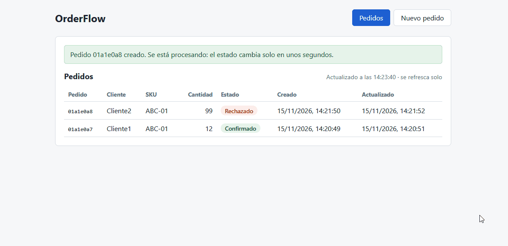
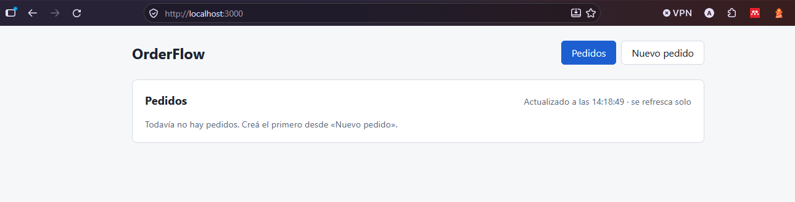
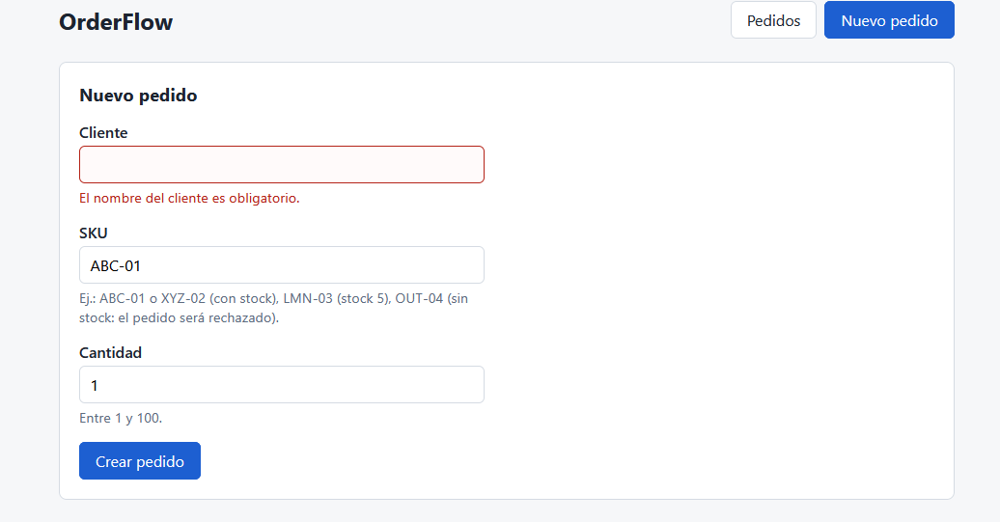
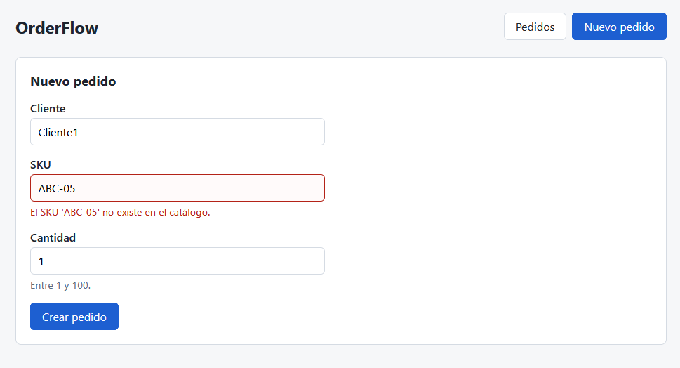
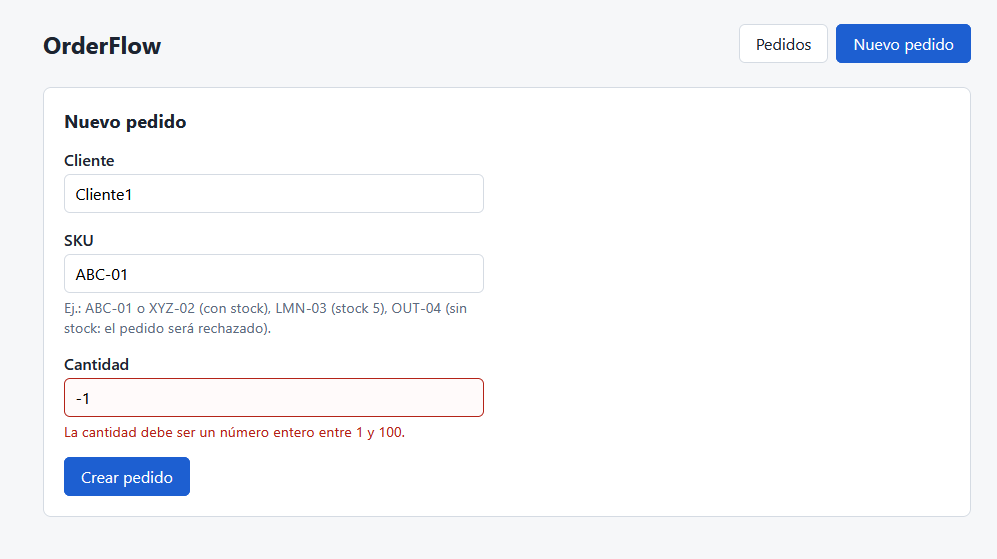
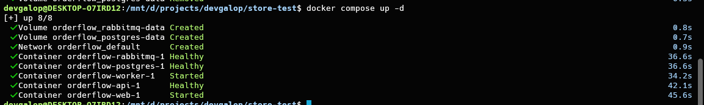
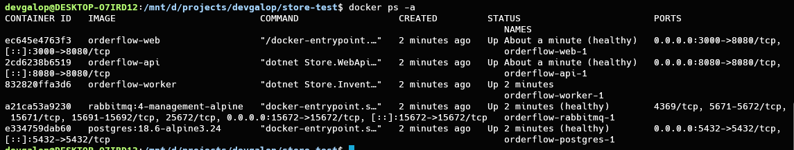
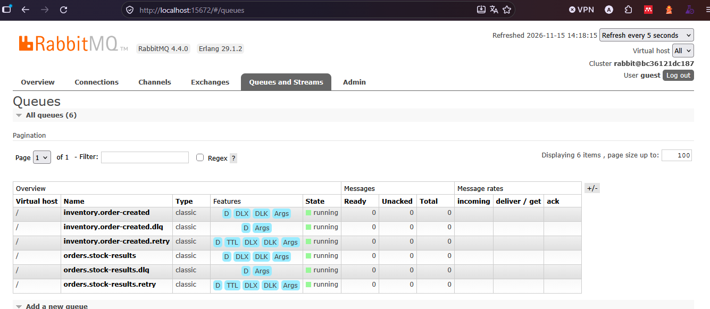

# Evidencias de funcionamiento

El flujo de creación, procesamiento y confirmación de pedidos se evidencia en el siguiente conjunto de capturas y registros:

## Flujo completo de creación de pedidos

## Pantallas del panel web

## Errores en el formulario

## Creación de docker compose

## Contenedores corriendo

## Administrador Rabbit

